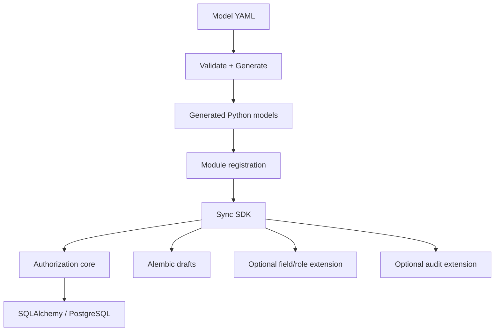

# Technical Design: KeelModel v1

## Purpose

Define the minimum implementation contracts for KeelModel v1: model schema, generated Python models, explicit module registration, synchronous data access, core authorization via `keelpolicy`, Alembic draft generation, and extension boundaries for optional field/role auth and audit.

## Principles

- YAML is the single source of truth for declarative model and policy definitions.
- Runtime flow is linear and explicit: load declarations -> validate -> generate models -> register modules -> execute data operations -> return typed results or structured errors.
- Keep abstraction to at most two layers where possible: schema layer and execution layer.
- Default deny authorization; deny wins on conflicts.
- Denied read fields are omitted from typed partial results; denied write fields reject the whole operation.
- Bulk writes are atomic batches; a denied record or field fails the batch.

## Scope Gate

In scope for first implementation pass:

1. Model YAML v1 validation and deterministic Python model generation to application/module-owned paths; composite fields are deferred.
2. Explicit module registration with declared dependencies and public exports.
3. Synchronous data API over SQLAlchemy/PostgreSQL for basic CRUD/query/transaction and atomic bulk operations.
4. `keelpolicy` action/record authorization as core enforcement.
5. Alembic migration draft generation for review.
6. Extension interfaces for optional field-level authorization and audit; role matching belongs to policy core.

Out of scope for v1 core:

- Async API.
- Auto-discovery of modules, HTTP transport, UI, workflow engine, identity/user store.
- Soft delete, DataView, search/outbox worker, custom Field protocol, multiple database backends.
- Automatic migration application; migrations are reviewed and applied explicitly.

## Data Flow

## Contracts

### Model YAML v1

Each model file declares:

- module and model name
- fields and types
- relations
- constraints and optional indexes
- optional capability metadata
- optional extension class reference for behavior only

The schema is strict, versioned, and validated before generation. No hidden schema merge between YAML and Python. v1 supports UUID, text, integer, decimal, boolean, date, timezone-aware datetime, bytes, enum, JSON, URL, and JSONB-backed typed FileReference/Location; composite fields are deferred. Relations include many-to-one, one-to-one, and one-to-many; many-to-many uses explicit junction models. Check constraints use structured basic predicates. Generated output belongs to the application/module; UUID and timestamp fields are explicit mixins.

### Generated Python Models

- Deterministic output into an application/module-owned generated directory outside the SDK package.
- Committed in source control.
- Never hand-edited.
- Drift check regenerates code and fails on diff.

Generated models expose typed model classes and field descriptors that can be used to build query expressions without string parsing.

### Module Registry

- One module per package boundary.
- Explicit registration only.
- Validates module identity, declared dependencies, version ranges, and public exports.
- Rejects dependency cycles and name collisions.
- Registration has no database or network side effects.

### Sync Data API

- Synchronous Python SDK only in v1.
- Exposes basic CRUD, query, explicit transaction/session reuse, and bulk operations.
- Structured, transport-neutral errors.
- Bulk operations are atomic; one denied record or field rejects the whole batch.

### Authorization / `keelpolicy`

- Application owns policy YAML and trusted context.
- `keelpolicy` evaluates policy only; it does not own authentication, identity, user storage, or role assignment.
- Policy supports action, resource, role selectors from trusted context, record-scope conditions, and basic context conditions.
- Default deny; deny wins. Initial conditions include equality/inequality, compatible ordered comparisons, membership, null check, and `all`/`any` groups.
- Unsupported rule features fail validation, not silent ignore.

KeelModel applies authorization decisions inside supported SDK operations. Raw SQL/direct SQLAlchemy usage outside the SDK is outside this protection boundary.

### Read / Write Semantics

- Reads return typed partial results. Denied fields are omitted, not set to null. Filtering and ordering each require explicit policy capability separate from read.
- Writes reject the whole operation if any submitted field is denied.
- Record-level conditions are translated to database predicates where supported.

### Bulk Semantics

- Bulk operations share one transaction boundary.
- Batch is atomic: any denial or hard validation failure rolls back the entire batch.
- Return shape is typed and explicit; no hidden partial success for the main write path.

### Migrations

- Alembic remains the migration owner.
- KeelModel generates draft revisions for review.
- Module/application explicitly applies migrations.
- No schema mutation is triggered automatically at startup or registration.

### Extensions

Optional extension contracts are defined but not broad frameworks:

- **Field authorization extension:** supplies optional field read/create/update/filter/order decisions. Role matching for action/record policies stays in authorization core.
- **Audit extension:** writes audit entries in the same transaction as the mutation.

Extension usage must be explicit. Missing required extension + policy that uses its rules is a configuration error, not ignored behavior.

## Initial Feature Decomposition

1. Contract freeze: YAML grammar, module manifest, SDK surface, policy schema, error taxonomy.
2. Tooling/package foundation.
3. YAML validation + deterministic code generation.
4. Runtime model registry and PostgreSQL metadata mapping.
5. Sync transaction/CRUD/query API.
6. Bulk operations.
7. `keelpolicy` core evaluation.
8. Core authorization integration.
9. Alembic draft generation.
10. Field-level authorization extension boundary.
11. Audit extension boundary.
12. Verification and docs.

## Open Technical Risks

- Exact supported operators and field semantics still need schema-level definition.
- Bulk result shape and rollback behavior need precise API design.
- Field/role extension contract must be narrow enough to avoid becoming a generic plugin system.
- Audit payload and redaction format need a concrete schema before implementation.
- Security-sensitive authorization paths require adversarial integration tests.

## Implementation Notes

- Prefer small, explicit contracts over a broad framework surface.
- Keep all runtime checks on supported SDK paths; do not promise coverage for direct database access.
- Keep YAML strict and versioned; do not infer missing structure.
- Keep extension points minimal and behavior-focused, not generic hook pipelines.
